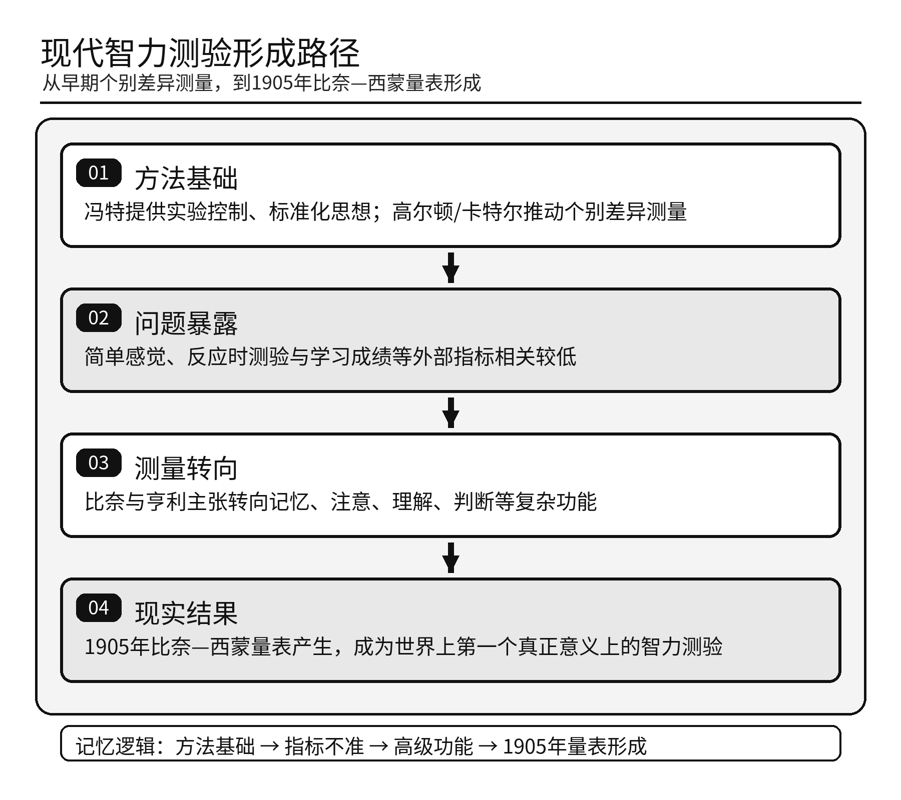

# 第1章 心理测量和测验的历史回顾

## 一、心理测量和测验产生的背景P3（二级）

现代**心理测量和测验**形成于**19世纪欧洲**，直接动力是<u>评定心理特征的个别差异</u>。

日常语言可以描述个体差异，但科学心理学需要把差异转化为**可操作**、**可比较**、**可解释**的测量结果。

心理测量的基本任务，是<u>用有效方法对心理差异进行定量刻画</u>。

心理测量与**实验方法**共同构成心理学实证研究的重要范式：心理测量偏重<u>个体差异的测定</u>，实验方法偏重<u>变量关系的控制与解释</u>。

## 二、中国古代的心理测量思想和实践P3（三级）

中国古代心理测量属于低频历史内容，了解教材给出的基本线索即可。

### （一）心理测量完整实践的三个前提P3（二级）

心理测量的完整实践至少包括三个前提：

1.**可测性**：承认<u>心理特征存在个别差异并可以测量</u>；

2.**测量内容**：明确<u>测量何种心理特征</u>，并有理论说明；

3.**测量方法**：把测量内容<u>操作化并以适当形式呈现</u>。

### （二）古代心理测量思想P4

1.**孔子**提出“**性相近也，习相远也**”，体现对**个别差异**的认识；“**上智**”“**下愚**”体现早期**分类思想**。

2.**孟子**提出“**权，然后知轻重；度，然后知长短。物皆然，心为甚**”，体现<u>心理能力和心理特征具有可测量性</u>。

3.**刘劭**《**人物志**》强调**察举用人**和**品鉴人才**，其“**考课核实**”体现<u>内部心理与外部行为相统一</u>的观察思想。

4.**八观与五视**用于减少观察偏差，说明古代人才评定已经注意到<u>观察者主观偏好和被观察者表里不一</u>的问题。

### （三）古代心理测量实践P5

1.**科举取士制度**是中国古代最有代表性的心理与教育测量实践，初萌于**商周**，兴盛于**隋唐**，延续至清末。

2.科举制度的测量意义主要体现在：有**选拔目的**、有相对稳定的**测验内容**，并形成**帖经**、**墨义**、**口义**、**策论**、**诗赋**等测验形式。

3.民间测量活动包括《**学记**》、《**礼记·本命**》、“**周岁试儿**”、**七巧板**、**九连环**等，分别涉及教育测验、年龄发展线索、婴儿行为诊断、空间想象和问题解决。

## 三、近代心理测量的早期尝试与先驱者探索P6（二级）

近代心理测验的早期探索有两条线索：一是<u>智力落后儿童的分类与训练需要</u>，二是<u>实验心理学和个别差异研究提供测量方法</u>。

### （一）智力落后儿童的分类与训练P6（三级）

19世纪以前，**智力落后者**常被与**精神异常者**混同。特殊教育和医疗机构的发展，使人们需要建立<u>标准而客观的分类方法</u>。

1.**艾斯克罗**：正式区分**智力落后者**和**精神异常者**，并指出<u>语言能力是判断智力水平的重要指标</u>。

2.**塞甘**：训练智力落后者的先驱，提出“**心理训练法**”，创办第一所教育智力落后儿童的学校，并发展**感官训练**、**肌肉训练**和**塞甘形板**。

3.**比奈**：后来推动鉴别<u>不能适应正常学校学习但仍可教育的儿童</u>，为智力测验产生提供现实需求。

### （二）冯特实验心理学的影响P7

**冯特**于**1879年**在德国莱比锡大学建立第一所心理学实验室。

冯特实验心理学不直接研究个别差异测量，但对心理测量有两点影响：

1.研究内容上，早期实验心理学重视**视觉**、**听觉**、**感觉器官敏感性**和**反应时**，这些内容进入早期心理测验；

2.研究方法上，实验心理学强调**情境控制**，这一思想后来发展为心理测验中的**标准化**。

标准化的核心意义，是<u>在统一情境下观察所有受试者</u>。

### （三）高尔顿的贡献P8

**高尔顿**是<u>直接推动测验运动发展的第一人</u>，也是最早实际从事测验活动的学者之一。

高尔顿的主要贡献包括：

1.提出“**测验**”和“**心理测量**”相关术语；

2.1884年设立“**人体测量学实验室**”，测量身高、体重、视觉和听觉敏锐度、肌肉强度、反应时等，并积累**9337人**资料；

3.主张通过**感觉辨别力**估量智力，认为感觉辨别力越强，判断力和智力活动范围越大；

4.设计**高尔顿棒**、**高尔顿哨**等仪器，并较早采用**评定量表**、**问卷法**和**自由联想技术**；

5.发展个别差异资料的统计分析方法，提出**相关**概念，其学生**皮尔逊**后来完善相关计算方法。

高尔顿的核心意义在于<u>把个别差异研究推进为实际测量活动</u>，并推动统计方法进入心理测量。

### （四）卡特尔及其早期个别差异研究P9

**卡特尔**早年师从冯特，后受高尔顿影响，转向**个别差异**和**测验研究**。

1890年，卡特尔发表《**心理测验与测量**》，这是“**心理测验**”一词第一次出现在心理学文献中。

卡特尔对测验编制的主要观点：

1.心理学必须建立在**实验与测量**基础上，才能具有自然科学的准确性；

2.测验必须规定**统一程序**，使不同时间、地点获得的结果<u>能够比较和综合</u>。

卡特尔设计的测验项目包括**握力**、**动作速度**、**触觉两点阈**、**痛觉阈**、**重量辨别**、**声音反应时**、**颜色命名速度**、**线段平分**、**时间判断**和**字母复述**。

这些项目延续高尔顿思路，试图<u>通过感觉辨别力和反应时测量智力功能</u>。但结果显示，这些测验与教师评定、学习成绩等外部指标相关较低。

卡特尔早期测验的不足，促使后来研究者<u>转向更复杂心理功能的测量</u>。

### （五）复杂心理功能测验的探索P10

1.**克雷丕林**：建议在**精神病理学**中使用测验，测量练习效果、记忆力、疲劳和分心易感性等。

2.**艾宾浩斯**：1896年首创复杂的**语句完成测验**，该测验与儿童学业成就显著相关。

3.**比奈与亨利**：批评早期测验过分强调感觉，主张测量**记忆力**、**想象力**、**注意力**、**理解力**、**受暗示性**、**道德情感**和**意志力**等复杂功能。

这一转向的意义在于：心理测验逐渐从<u>简单感觉和反应时测量</u>，转向<u>复杂高级心理功能测量</u>。

**铁头tips**

现代智力测验形成路径P7-P11

## 四、社会需要与现代心理测验的形成P10（二级）

心理测量的发展并不只是理论推动的结果，社会实践中的筛查、鉴别、教育和选拔需要，是心理测验成熟的重要动力。

社会需要是<u>心理测量和测验发展的动力</u>。

### （一）比奈和世界上第一个智力测验P11（一级）【20年真题；考纲】

**比奈**被称为**心理测验的鼻祖**。世界上第一个真正意义上的智力测验，是**比奈—西蒙量表**（又译**比内—西蒙量表**）。

1.**测量路径的转变**

比奈早期尝试过头盖骨、手形、字迹等指标，但发现这些方法无法有效评定个体智力。

因此，比奈转向<u>从智力本身及其外显操作结果入手</u>。

2.**比奈的智力观**

1903年，比奈出版《**智力的实验研究**》。他认为智力是广义的，包含一切高级心理过程，主要表现为**推理**、**判断**和**运用旧知识解决新问题**的能力。

比奈的核心主张是<u>直接选择广泛而复杂的课题来测量智力</u>。

3.**比奈—西蒙量表的产生**

1904年，法国教育部委托比奈研究教育智力落后儿童的方法。

比奈与**西蒙**合作完成**比奈—西蒙量表**。1905年，比奈在《**心理学年报**》发表《**诊断异常儿童的新方法**》，详细介绍该量表，因此又称**1905年量表**。

1908年和1911年，比奈两次修订该量表。1916年，美国斯坦福大学**推孟**修订该量表，形成**斯坦福—比奈量表**。

本知识点核心信息：**1905年**、**比奈—西蒙量表**、<u>世界上第一个真正意义上的智力测验</u>。

**铁头tips**

例如  比奈不再用“头大不大、手长不长”判断儿童聪不聪明，而是让儿童完成词语、图片解释、推理判断等任务。这样更像直接观察儿童怎样思考，而不是隔靴搔痒地测身体特征。

**铁头tips**

补充内容：**比奈/比内译名**

教材常写作**比奈**，部分真题或资料会写作**比内**，二者通常指同一人 **A. Binet**。看到“**比内—西蒙量表**”时，要对应到教材中的**比奈—西蒙量表**。

**铁头tips**

易混辨析：**比奈—西蒙量表**与**斯坦福—比奈量表**P11

| 对比项 | **比奈—西蒙量表** | **斯坦福—比奈量表** |
| --- | --- | --- |
| 时间 | **1905年** | **1916年** |
| 编制/修订者 | **比奈**与**西蒙** | 斯坦福大学**推孟**修订 |
| 地位 | <u>世界上第一个真正意义上的智力测验</u> | 比奈量表在美国的重要修订版 |
| 易混点 | 真题问“1905年第一个智力测验”选它 | 不要把1916年的修订版误当成1905年原始量表 |

### （二）团体测验的产生P11（二级）

**团体测验**的产生，是<u>大规模筛查和分类需要</u>推动的结果。

**比奈—西蒙量表**属于**个别测验**：每次只能施测一名受测者，许多题目需要口头反应或操作材料，对主试训练要求较高，更适合临床个案分析。

第一次世界大战期间，美国心理学会在**耶克斯**指导下，试图根据士兵一般智力水平进行快速分类、安置和选拔，个别测验无法满足这种大规模需要。

团体智力测验的重要基础之一是**奥提斯**的团体智力测验。奥提斯的贡献是<u>首先使用多项选择题和其他客观题形式</u>。

最终形成的军队测验包括：

1.**陆军A式量表**，又称**陆军甲种测验**，属于**文字测验**；

2.**陆军B式量表**，又称**陆军乙种测验**，属于**非文字测验**，适用于文盲和不懂英语的新兵。

团体测验的意义在于<u>降低大规模施测成本</u>，使心理测验从临床个案扩展到教育、军队和社会选拔领域。

**铁头tips**

易混辨析：**个别测验**与**团体测验**P11

| 对比项 | **个别测验** | **团体测验** |
| --- | --- | --- |
| 施测对象 | 每次主要测一名受测者 | 可同时测很多人 |
| 施测要求 | 主试训练要求较高，常需口头反应或操作材料 | 指导语和程序更简化，适合大规模施测 |
| 代表测验 | **比奈—西蒙量表** | **陆军甲种测验**、**陆军乙种测验** |
| 适用场景 | 临床个案、深入分析 | 军队、学校、选拔、筛查 |
| 记忆抓手 | “一对一精细测” | “一批人快速筛” |

## 五、心理测量和测验在我国的发展P13（三级）

我国心理测量发展史属于低频历史内容，按阶段线索了解即可。

### （一）1949年之前：引入、发展与停滞P13

20世纪初，科学心理测验传入中国，并首先在教育领域发展。

保留四个节点：**1916年**樊炳清介绍**比奈—西蒙量表**；**1920年**廖世承和陈鹤琴开设测验课程；**1931年**中国测验学会成立；**1932年**会刊《**测验**》创刊。

这一阶段先繁荣后停滞，原因包括<u>滥用测验、施测训练不足、结果解释不慎重</u>，以及抗日战争后测验工作中断。

### （二）1949年至1978年：停止发展的时期P15

1949年至1978年，心理测验在我国长期被视为禁区，教学、研究和应用基本停止。

这一阶段理解为：心理测验的发展受到<u>苏联批判儿童学、否认个别差异和特殊社会环境</u>的影响。

### （三）1978年以后：恢复与重新发展P16

1978年以后，心理测量和测验随心理学恢复而重新发展。

保留四个节点：**1978年**北京师范大学和**华东师范大学**等高校开始招收心理测量专业研究生；**1979年**武汉举办第一个全国性心理测验培训班；恢复初期引进**经典测验理论（CTT）**、**概化理论（GT）**和**项目反应理论（IRT）**；20世纪80年代中期以后开始编制适合中国人的心理测验工具。

### （四）改革开放40多年发展的特点P17

改革开放40多年我国心理测量发展的特点，可以概括为三点：

1.**测验和量表增多，质量提升**：认知类、非认知类、职业类、临床类和儿童发展类量表不断增加；

2.**应用领域扩展**：心理测验进入教育、人才选拔、职业选择、临床与精神卫生等领域；

3.**理论与技术结合**：测验研发依托**CTT**、**IRT**、**GT**，并结合多元统计、计算机化测验和**计算机自适应测验（CAT）**。

我国心理测量未来发展的关键，是<u>规范化、标准化、本土化和计算机化</u>。
